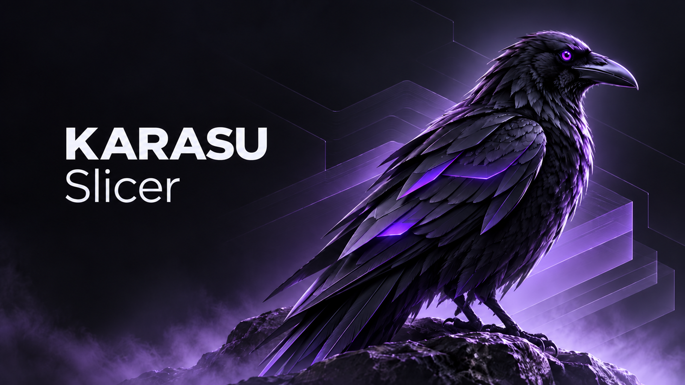
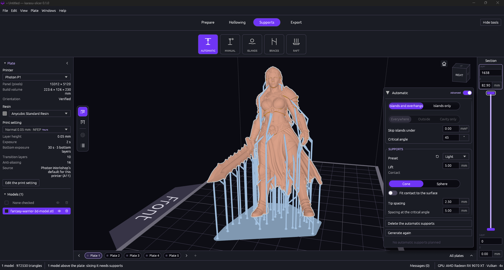

<p align="center">
  
</p>

<p align="center">
  <a href="https://github.com/dazeroit/karasu-slicer/actions/workflows/ci.yml"></a>
  <a href="LICENSE"></a>
  
  
  <a href="https://discord.gg/A7wygpqGw"></a>
</p>

# karasu-slicer

karasu-slicer is an independent, cross-platform slicer for MSLA/LCD resin 3D printers, written in
native Rust. It prepares models for printing and writes the files resin printers read, with
geometric correctness, numerical robustness, deterministic output and memory safety first.

- **Desktop application** (`karasu`, Windows and Linux): import STL, OBJ and 3MF models; place,
  orient and repair them on one or more plates; hollow them, place drain holes, add automatic
  or manual supports, braces and rafts; slice, preview the layers and export the printer's file.
  Projects are saved as `.karasu` files; prepared models can be exported as STL, 3MF or OBJ.
- **Command line** (`karasu-cli`): inspect models and slice them headlessly into printer files or
  reference images.
- **Printers:** the built-in catalog below, and custom printers described by their panel and
  file format.

<p align="center">
  
  <br>
  <sub>Automatic supports on a miniature. Model:
  <a href="https://www.printables.com/model/1746548-female-barbarian-warrior-miniature-fantasy-tableto">Female Barbarian Warrior Miniature</a>
  (Printables, <a href="https://creativecommons.org/publicdomain/zero/1.0/">CC0 1.0</a>).</sub>
</p>

The software is under active development and has not been released yet; see
[ROADMAP.md](ROADMAP.md) for the milestones and their status.

## Supported printers

The printers of the built-in catalog and the file each one reads. **Image orientation** says
whether the layer image's orientation on the printer's screen has been checked against another
slicer's file for the same model; until it has, a part may print mirrored or turned. **Printed
with karasu-slicer** says whether karasu-slicer's files have been printed on that printer. Where each value comes from:
[docs/CATALOG-SOURCES.md](docs/CATALOG-SOURCES.md).

<!-- supported-printers: generated by tools/assets/make_catalog.py -->
| Vendor | Printer | File | Image orientation | Printed with karasu-slicer |
| --- | --- | --- | --- | --- |
| Anycubic | Photon | .photon, .pws | not verified | not yet |
| Anycubic | Photon D2 | .dl2p | not verified | not yet |
| Anycubic | Photon M3 | .pm3 | not verified | not yet |
| Anycubic | Photon M3 Max | .pm3m | not verified | not yet |
| Anycubic | Photon M3 Plus | .pwmb | not verified | not yet |
| Anycubic | Photon M3 Premium | .pm3r | not verified | not yet |
| Anycubic | Photon Mono | .pwmo | not verified | not yet |
| Anycubic | Photon Mono 2 | .pm3n | not verified | not yet |
| Anycubic | Photon Mono 4 | .pm4n | not verified | not yet |
| Anycubic | Photon Mono 4K | .pwma | not verified | not yet |
| Anycubic | Photon Mono M5 | .pm5 | not verified | not yet |
| Anycubic | Photon Mono M5s | .pm5s | not verified | not yet |
| Anycubic | Photon Mono M5s Pro | .m5sp | not verified | not yet |
| Anycubic | Photon Mono SQ | .pmsq | not verified | not yet |
| Anycubic | Photon Mono X | .pwmx | not verified | not yet |
| Anycubic | Photon Mono X 6K | .pwmb | not verified | not yet |
| Anycubic | Photon Mono X 6Ks | .px6s | not verified | not yet |
| Anycubic | Photon Mono X2 | .pmx2 | not verified | not yet |
| Anycubic | Photon P1 | .pp1 | verified | yes (2026-11-03) |
| Anycubic | Photon S | .pws | not verified | not yet |
| Anycubic | Photon Ultra | .dlp | not verified | not yet |
| Anycubic | Photon Zero | .pw0 | not verified | not yet |
| Elegoo | Jupiter 2 | .goo | not verified | not yet |
| Elegoo | Jupiter SE | .goo | not verified | not yet |
| Elegoo | Mars 4 | .goo | verified | not yet |
| Elegoo | Mars 4 Max | .goo | not verified | not yet |
| Elegoo | Mars 4 Ultra | .goo | verified | not yet |
| Elegoo | Mars 5 | .goo | not verified | not yet |
| Elegoo | Mars 5 Ultra | .goo | not verified | not yet |
| Elegoo | Saturn 3 | .goo | verified | not yet |
| Elegoo | Saturn 3 Ultra | .goo | verified | not yet |
| Elegoo | Saturn 4 | .goo | not verified | not yet |
| Elegoo | Saturn 4 Ultra | .goo | not verified | not yet |
| Elegoo | Saturn 4 Ultra 16K | .goo | verified | not yet |
<!-- /supported-printers -->

## Building

Prerequisites: the stable Rust toolchain, 1.100 or later (Cargo, rustfmt and Clippy).
On Windows, the MSVC build tools. On Linux, a Vulkan or OpenGL (EGL) driver and an X11 or Wayland
session to run the application.

```console
cargo build --workspace --release
cargo run --release -p karasu-app
cargo run --release -p karasu-cli -- --help
```

Packages (a portable ZIP and an installer for Windows, a tar.gz and a `.deb` for Linux) are
assembled from the release executables; see [tools/packaging/README.md](tools/packaging/README.md).

## Checks before a change

```console
cargo fmt --all -- --check
cargo clippy --workspace --all-targets -- -D warnings
cargo test --workspace
cargo build --workspace
RUSTDOCFLAGS="-D warnings" cargo doc --workspace --no-deps --document-private-items
RUSTDOCFLAGS="-D warnings" cargo doc --workspace --no-deps
git diff --check
```

Native Windows runs follow [tools/windows-native/README.md](tools/windows-native/README.md).
Pull requests run these checks on Linux and Windows (`.github/workflows/ci.yml`).

## Repository layout

- `crates/karasu-core`: the headless geometry, slicing, preparation and export engine.
- `crates/karasu-project`: projects, plates, the shared pipeline and the profile library.
- `crates/karasu-app`: the desktop application (egui, wgpu).
- `crates/karasu-cli`: the command line.
- `assets/`: interface images, icons, translations and the printer catalog.
- `tools/`: packaging, validation and measurement tools.
- `docs/`: architecture, decisions, specifications, validation records and research.

## Documentation

- [docs/ARCHITECTURE.md](docs/ARCHITECTURE.md): architecture, coordinate and numerical conventions.
- [docs/WORKSPACE.md](docs/WORKSPACE.md): crates, naming and compatibility.
- [docs/CLI.md](docs/CLI.md): the command line, model formats and inspection report.
- [docs/UI-DESIGN.md](docs/UI-DESIGN.md): the interface's design rules.
- [docs/TECHNOLOGY-DECISIONS.md](docs/TECHNOLOGY-DECISIONS.md): decisions and open questions.
- [docs/TEST-STRATEGY.md](docs/TEST-STRATEGY.md): how the software is tested.
- [docs/RELEASE-PROCESS.md](docs/RELEASE-PROCESS.md): branches, versions and releases.
- [docs/MILESTONE-NOTES.md](docs/MILESTONE-NOTES.md): what each engine milestone added.
- [docs/CATALOG-SOURCES.md](docs/CATALOG-SOURCES.md): the printer catalog's sources and limits.
- [docs/FUZZ-CAMPAIGNS.md](docs/FUZZ-CAMPAIGNS.md): fuzz target protocols and campaign records.
- [docs/TOOL-RECORDS.md](docs/TOOL-RECORDS.md): results and history of the development tools.
- [docs/research/](docs/research/): research records.
- [ROADMAP.md](ROADMAP.md): milestones and status.

## Help and community

Ask questions and talk with other users on the [Discord server](https://discord.gg/A7wygpqGw).
Report bugs and request features with the
[issue forms](https://github.com/dazeroit/karasu-slicer/issues/new/choose).

## Contributing

Read [CONTRIBUTING.md](CONTRIBUTING.md): contributions are accepted under the project's
Contributor Licence Agreement ([CLA.md](CLA.md)). [AGENTS.md](AGENTS.md) holds the project's
permanent rules. In short:

- Every project artifact is written in English (translation catalogs excepted).
- Geometry and slicing are native Rust; C/C++ geometry kernels and FFI wrappers around them are
  not used, and `unsafe` code is forbidden.
- Clean room: other programs, commercial or open source, are behavioural references only; their
  code is never read or copied.
- Dependencies need a recorded review before they are added.
- Each change comes with its tests and passes the checks above.

## Security

Report vulnerabilities privately, as [SECURITY.md](SECURITY.md) describes, not in public issues.

## Licence

Copyright (C) 2026 Ivan Maruca.

karasu-slicer is free software: you can redistribute it and/or modify it under the terms of the
GNU Affero General Public License as published by the Free Software Foundation, either version 3
of the License, or (at your option) any later version ([LICENSE](LICENSE)). It is distributed
without any warranty.

The name karasu-slicer and its logo are trademarks and are not licensed with the code: see
[TRADEMARKS.md](TRADEMARKS.md). The licences of the third-party crates compiled into the
programs are listed in the packages' `THIRD-PARTY-NOTICES.txt`.
